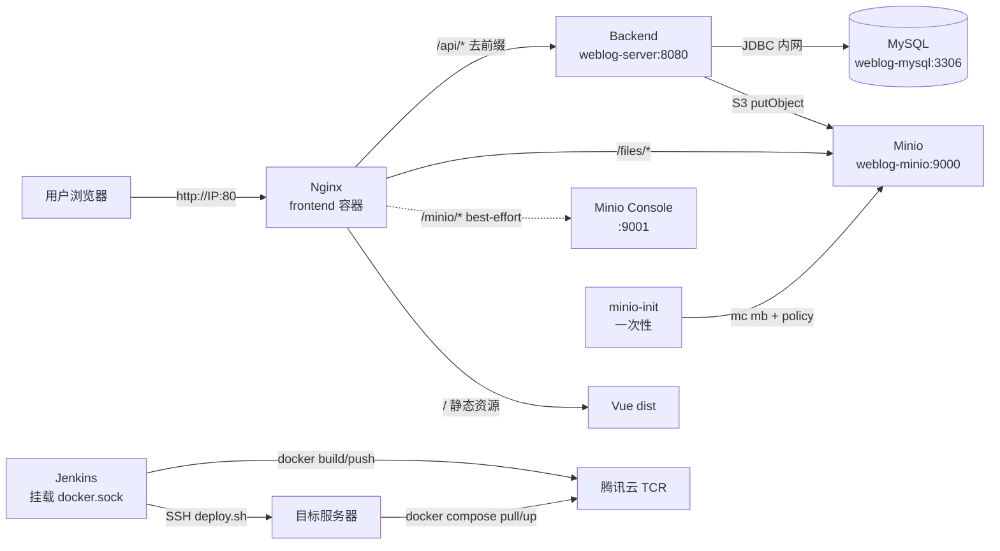
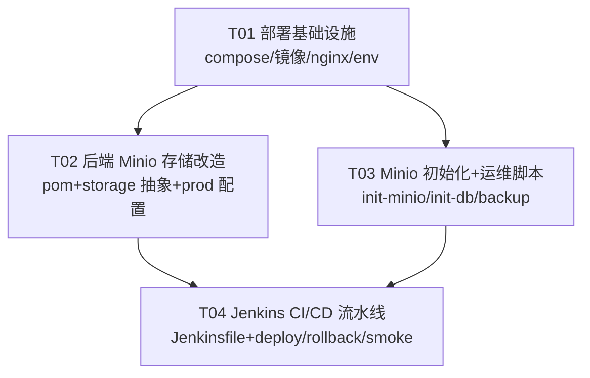

# Weblog Docker 化 + Jenkins CI/CD 系统架构设计与任务分解

> 架构师：高见远（Bob）
> 输入：PRD《05-Docker-Jenkins部署PRD.md》+ 团队最终决策（Java 8 / 腾讯云 TCR / IP 直连暂不做 HTTPS / Jenkins 同机部署）
> 目标服务器：腾讯云轻量 `62.234.30.116`（Ubuntu 24.04，2 核 4G）

---

## Part A：系统设计

### 1. 实现方案（技术难点 + 框架选型 + 架构模式）

#### 1.1 核心技术难点

| # | 难点 | 分析 | 应对方案 |
|---|------|------|----------|
| D1 | **Java 8 与 Minio SDK 兼容** | 项目锁定 Java 8（Spring Boot 2.7.18 + `maven:3.9-eclipse-temurin-8`），Minio Java SDK 高版本可能上探 JDK 11 | 选用 `io.minio:minio:8.5.x`（8.5.7，最低 JDK 8）；如遇兼容问题回退 8.5.2。除新增此依赖外**不改 pom 的 Java 版本** |
| D2 | **2C4G 单机承载 5 容器 + Jenkins** | MySQL + Minio + 后端 JVM + Nginx + Jenkins + Docker daemon 稳态即逼近 3G，CI 构建期（Maven/Node 容器）瞬时冲顶 | 逐服务 `mem_limit`；MySQL 压 buffer pool、后端 `-Xmx512m`、Jenkins `-Xmx768m`；构建容器加 `--memory` 限制；详见 §6 资源评估 |
| D3 | **Minio 控制台子路径反代** | Minio Console 是根路径 SPA，挂在 `/minio/` 子路径下静态资源路径会错乱 | `/files`（对象下载）走 Nginx 反代是稳的；Console 本期推荐直接 `http://IP:9001` 访问，`/minio/` 仅作 best-effort 反代并注明风险 |
| D4 | **WebSocket 经 Nginx 反代** | 前端连接 `/api/chat/ws`，需正确透传 `Upgrade`/`Connection` 头，否则聊天室握手失败 | Nginx 单独为 `/api/chat/ws` 配 `proxy_http_version 1.1` + `Upgrade`/`Connection: upgrade` 升级头（见 §3.4） |
| D5 | **IP 直连 + 无域名的统一入口** | 无域名/无 HTTPS，前端、API、图片、Minio 都收敛到 `http://IP` 一个入口，路径要互不冲突 | 单 Nginx 网关：`/`(静态) + `/api/`(后端，去前缀) + `/files/`(Minio 对象) + `/minio/`(Console) + `/api/chat/ws`(WS)；SSL 在 nginx 预留 443 模板 |

#### 1.2 框架与镜像选型

| 用途 | 选型 | 理由 |
|------|------|------|
| 容器编排 | Docker Compose v2 | 单机 5 服务编排，`up -d` 一键拉起，声明式 + 数据卷 |
| 后端镜像 | `maven:3.9-eclipse-temurin-8` → `eclipse-temurin:8-jre` | 多阶段构建，产物 ~200MB，Java 8 不变 |
| 前端镜像 | `node:18-alpine` → `nginx:1.25-alpine` | 前端构建 + Nginx 网关一体，与现有部署一致 |
| MySQL | `mysql:8.0` | 生产 MySQL 8，utf8mb4，健康检查用 `mysqladmin ping` |
| Minio | `minio/minio` + `minio/mc`（一次性初始化） | 对象存储/图床，替代本地 `./uploads`；`mc` 建桶 + 匿名下载策略 |
| Jenkins | `jenkins/jenkins:lts-jdk17` + `docker:24-cli` | 官方 LTS；挂载宿主 `/var/run/docker.sock`，免 DinD 省内存 |
| 对象存储 SDK | `io.minio:minio:8.5.7` | Java 8 兼容，S3 协议，生产图床 |
| 镜像仓库 | 腾讯云 TCR 个人版 `ccr.ccs.tencentcloud.com` | 国内拉取快，私有仓库，团队决策 |

#### 1.3 架构模式

- **分层架构（后端）**：`Controller → Service → FileStorage 抽象层`。新增 `FileStorage` 接口 + `LocalFileStorage`（开发）/ `MinioFileStorage`（生产）双实现，通过 `weblog.storage.type` 条件装配切换，Controller 层无感知。
- **单入口网关（网络）**：所有流量经 `frontend` 容器内 Nginx 收敛，MySQL/Minio/后端均不对外暴露（仅 compose 内网互访）。
- **声明式交付 + 自动化**：`docker-compose.yml` 描述稳态；Jenkinsfile 描述交付流水线（构建→测试→推镜像→SSH 部署→健康校验→失败回滚）。

---

### 2. 文件列表（相对路径）

```
weblog/
├── Jenkinsfile                                        # [新增] CI/CD 流水线（仓库根，Jenkins 默认入口）
├── .dockerignore                                      # [确认/微调] 排除 node_modules/dist/target/uploads/lucene-index/.env
├── deploy/
│   ├── docker-compose.yml                             # [重写] 5 常驻服务 + minio-init 一次性服务
│   ├── .env.example                                   # [修改] MySQL/Minio/JWT/TCR/Jenkins 环境变量模板
│   ├── backend.Dockerfile                             # [微调] 后端多阶段构建（Java 8 不变）
│   ├── frontend.Dockerfile                            # [微调] npm ci + 构建 + Nginx
│   ├── jenkins.Dockerfile                             # [新增] Jenkins LTS + Docker CLI
│   ├── nginx.conf                                     # [修改] 静态 + /api + /files + /minio + WS 反代
│   ├── nginx.ssl.conf.example                         # [新增·预留] HTTPS 443 模板（本期不启用）
│   └── scripts/
│       ├── init-minio.sh                              # [新增] 创建 bucket + 匿名下载策略
│       ├── init-db.sh                                 # [新增] 等待 MySQL 健康 + 校验表结构（幂等）
│       ├── backup.sh                                  # [新增] mysqldump + mc mirror 定时备份（P2）
│       ├── deploy.sh                                  # [新增] pull 镜像 + 滚动部署 + 健康检查 + 失败回滚
│       ├── rollback.sh                                # [新增] 回滚到上一镜像 tag
│       └── smoke-test.sh                              # [新增] 冒烟测试（/health、首页、/api、/files、WS）
├── weblog-server/
│   ├── pom.xml                                        # [修改] 仅新增 minio SDK 依赖，JDK 版本不动
│   └── src/main/
│       ├── java/com/yuhao/weblog/
│       │   ├── config/MinioConfig.java                # [新增] MinioClient 条件装配 Bean
│       │   ├── common/storage/FileStorage.java        # [新增] 存储抽象接口
│       │   ├── common/storage/LocalFileStorage.java   # [新增] 本地存储实现（迁移现有逻辑）
│       │   ├── common/storage/MinioFileStorage.java   # [新增] Minio 存储实现
│       │   └── module/admin/service/impl/FileServiceImpl.java  # [修改] 改为委托 FileStorage
│       └── resources/application-prod.yml             # [修改] storage.type + Minio 配置 + 数据源/JWT 环境变量化
└── weblog-web/                                        # 前端无需改动（axios baseURL 已为 /api，vite 已走相对路径）
```

> 说明：`docs/system_design.md`、`docs/sequence-diagram.mermaid`、`docs/class-diagram.mermaid` 为本次架构产出物，不属于工程师实现文件。

---

### 3. 数据结构与接口

#### 3.1 服务依赖图（容器编排）



#### 3.2 类图（新增/修改的后端类）

详见 [`docs/class-diagram.mermaid`](./class-diagram.mermaid)，核心接口定义如下：

```java
/** 文件存储抽象：本地磁盘 / Minio 可配置切换 */
public interface FileStorage {
    String store(MultipartFile file);      // 存储并返回访问路径（如 /files/uuid.ext）
    void   delete(String objectName);       // 删除对象
    String buildUrl(String objectName);     // 构造对外访问 URL（统一 /files 前缀）
}
```

关键配置项（`application.yml` / `application-prod.yml`）：

```yaml
weblog:
  storage:
    type: ${WEBLOG_STORAGE_TYPE:local}   # local | minio；prod 默认 minio
  minio:
    endpoint: ${MINIO_ENDPOINT:http://minio:9000}
    access-key: ${MINIO_ACCESS_KEY:minioadmin}
    secret-key: ${MINIO_SECRET_KEY:minioadmin}
    bucket: ${MINIO_BUCKET:weblog}
  upload:
    url-prefix: /files                   # 对外访问前缀保持不变，前端无感知
```

#### 3.3 关键数据结构（对象命名与映射）

- **对象名**：`UUID(去横线) + 原扩展名`，存入 bucket `weblog`；前端拿到的 URL 为 `/files/<objectName>`。
- **Nginx 映射**：`/files/<obj>` → `http://minio:9000/weblog/<obj>`（bucket 设为匿名可读，图片直接静态访问，不经后端）。
- **本地模式兜底**：`storage.type=local` 时对象落在 `/app/uploads`，Nginx `/files/` 改指后端（nginx.conf 内已留注释切换项）。

#### 3.4 Nginx 反代关键配置（deploy/nginx.conf）

```nginx
# REST API（去 /api 前缀）
location /api/ {
    proxy_pass http://backend:8080/;
    proxy_set_header Host $host;
    proxy_set_header X-Real-IP $remote_addr;
    proxy_set_header X-Forwarded-For $proxy_add_x_forwarded_for;
    proxy_set_header X-Forwarded-Proto $scheme;
}

# WebSocket 聊天室（独立升级头）
location /api/chat/ws {
    proxy_pass http://backend:8080/chat/ws;
    proxy_http_version 1.1;
    proxy_set_header Upgrade $http_upgrade;
    proxy_set_header Connection "upgrade";
    proxy_set_header Host $host;
    proxy_read_timeout 3600s;
}

# 图片/附件对象（直连 Minio，匿名可读）
location /files/ {
    proxy_pass http://minio:9000/weblog/;
    proxy_set_header Host $host;
    expires 7d;
}

# Minio Console（best-effort；子路径下资源可能异常，推荐直接 http://IP:9001）
location /minio/ {
    proxy_pass http://minio:9001/;
    proxy_set_header Host $host;
    proxy_set_header X-Real-IP $remote_addr;
}

# 前端静态 + history 路由回退
location / { try_files $uri $uri/ /index.html; }
```

> SSL 预留：`deploy/nginx.ssl.conf.example` 提供 443 + `ssl_certificate` + 80→443 跳转模板，待域名/证书就绪后启用（本期跳过）。

---

### 4. 程序调用流程

完整时序（首次启动初始化 + 图片上传 + 图片访问 + CI/CD 部署）见 [`docs/sequence-diagram.mermaid`](./sequence-diagram.mermaid)，四条主链路如下：

1. **首次启动初始化**：`docker compose up -d` → MySQL 建库 → `minio-init` 建桶并设匿名下载策略 → 后端执行幂等 `schema.sql/data.sql` + `InitDataRunner` 建默认账号 + `LuceneIndexRunner` 从 MySQL 重建搜索索引。
2. **上传（写）**：前端 `POST /api/admin/file/upload` → Nginx 去 `/api` 前缀 → `AdminFileController` → `FileServiceImpl` → `MinioFileStorage.store()` → `MinioClient.putObject` → 返回 `{code:"10000", data:{url:"/files/uuid.ext"}}`。
3. **访问（读）**：浏览器 `GET /files/uuid.ext` → Nginx 直接反代 `minio:9000/weblog/`，不经过后端。
4. **CI/CD 部署**：push → Jenkins checkout → 后端 `mvn test` + 前端 `npm lint/build` → `docker build` 两镜像 → `docker push` 到 TCR → SSH 执行 `deploy.sh`（`pull` + `up -d` + 健康检查 + 失败回滚）。

---

### 5. Anything UNCLEAR（待明确事项）

1. **Minio Console 子路径反代**：Minio Console 为根路径 SPA，`/minio/` 子路径下资源路径可能错乱。本期推荐后台管理直接 `http://IP:9001` 访问；`/minio/` 仅作 best-effort。若后续接域名可改为 `img.<域名>` 独立反代。
2. **域名与 SSL**：团队决策「暂用 IP、HTTPS 跳过」，故本设计 nginx 仅 80 端口，SSL 以 `nginx.ssl.conf.example` 预留，待域名+备案+证书（certbot）就绪后启用。
3. **TCR 命名空间与凭证**：`ccr.ccs.tencentcloud.com/<namespace>/weblog-server:build-N` 需先在腾讯云 TCR 控制台建命名空间与长期访问凭证，并配入 Jenkins Credentials（`TCR_USERNAME`/`TCR_PASSWORD`），本设计无法代建。
4. **Minio 公开读策略**：为让 `/files` 直接经 Nginx 匿名访问，bucket 设为 `download` 公开读。若要求私有读（预签名 URL），前端 URL 生成与 Nginx 均需重构，复杂度上升，本期按公开读设计。
5. **存量数据迁移**：本设计按「全新部署」假设。旧服务器现有 MySQL 数据与 `uploads` 文件是否迁移进容器新卷，需另行确认迁移方案。
6. **Minio 集成范围**：本设计统一覆盖「所有上传文件走 Minio」（图片/封面/附件），如需仅图床，可只对图片启用。
7. **GitHub Actions `ci.yml` 去留**：建议保留作 PR 门禁（轻量 test/lint），Jenkins 负责构建+部署，职责分离；如需停用另行确认。
8. **Jenkins 内存上限**：2C4G 下 Jenkins `-Xmx768m` 为经验值，需实测；若 CI 构建期 OOM，需下调 MySQL buffer pool 或将 Jenkins 迁独立节点。

---

## Part B：任务分解

### 6. Required Packages（依赖清单）

**宿主机/基础环境（非代码依赖，需在服务器初始化时安装）**
```
- Docker Engine + Docker Compose v2（Ubuntu 24.04）
- git / curl / openssl
```

**后端 Maven 新增依赖（唯一 pom 变更，JDK 版本不动）**
```
- io.minio:minio@8.5.7: 对象存储 SDK（Java 8 兼容；如报兼容问题回退 8.5.2）
```

**前端 npm 依赖（无新增，沿用现有）**
```
- vue@^3.4.0 / vite@^5.0.0 / element-plus@^2.5.0 / pinia@^2.1.7 / axios@^1.6.5 / echarts@^5.4.3
```

**Docker 基础镜像（由 Dockerfile / compose 声明）**
```
- maven:3.9-eclipse-temurin-8          # 后端构建阶段
- eclipse-temurin:8-jre                # 后端运行阶段
- node:18-alpine                       # 前端构建阶段
- nginx:1.25-alpine                    # 前端运行 + 网关
- mysql:8.0                            # 数据库
- minio/minio (RELEASE 稳定版)          # 对象存储
- minio/mc (latest)                    # 一次性初始化 bucket
- jenkins/jenkins:lts-jdk17            # CI/CD 基座
- docker:24-cli                        # 为 Jenkins 注入 docker CLI
```

**Jenkins 插件（首次初始化时安装）**
```
- Pipeline / Git / Credentials Binding / SSH Agent（或 Publish Over SSH）/ Docker Pipeline
```

---

### 7. Task List（有序，按依赖关系）

> 实现顺序：T01 → {T02, T03}（可并行）→ T04。硬约束：**≤5 个任务，每任务 ≥3 文件，T01 为基础设施**。

#### T01 部署基础设施（容器编排 + 镜像 + 网关 + 环境变量）
- **优先级**：P0
- **依赖**：无
- **实现人**：工程师（DevOps）

| 文件 | 职责/写入内容 |
|------|--------------|
| `deploy/docker-compose.yml` | 5 常驻服务（mysql/minio/backend/frontend/jenkins）+ 1 一次性服务（minio-init）；健康检查、数据卷、`mem_limit`/`cpus`、镜像引用走 `IMAGE_REGISTRY/IMAGE_NAMESPACE/IMAGE_TAG` 环境变量 |
| `deploy/.env.example` | `MYSQL_ROOT_PASSWORD`、`WEBLOG_JWT_SECRET`、`MINIO_ROOT_USER/PASSWORD`、`MINIO_BUCKET`、`WEBLOG_STORAGE_TYPE`、`IMAGE_REGISTRY/NAMESPACE/TAG`、`JENKINS_PORT` 等模板 |
| `deploy/backend.Dockerfile` | 多阶段构建（`maven:3.9-eclipse-temurin-8` → `eclipse-temurin:8-jre`），保持 Java 8，注入 `JAVA_OPTS=-Xms256m -Xmx512m` |
| `deploy/frontend.Dockerfile` | `node:18-alpine` 用 `npm ci` 构建 → `nginx:1.25-alpine` 拷贝 dist + `nginx.conf` |
| `deploy/jenkins.Dockerfile` | `jenkins/jenkins:lts-jdk17` + 从 `docker:24-cli` 拷贝 docker CLI，`JAVA_OPTS=-Xmx768m` |
| `deploy/nginx.conf` | 静态托管 + `/api/`（去前缀）+ `/api/chat/ws`（升级头）+ `/files/`→Minio + `/minio/`→Console + history 回退 + gzip |
| `.dockerignore` | 确认排除 `weblog-web/node_modules`、`dist`、`weblog-server/target`、`uploads`、`lucene-index`、`.env` |
| `deploy/nginx.ssl.conf.example` |（可选·预留）443 + 证书路径 + 80→443 模板，本期不启用 |

#### T02 后端 Minio 存储改造 + 生产配置
- **优先级**：P0
- **依赖**：T01（环境变量名需与 compose 对齐）
- **实现人**：工程师（后端 Java）

| 文件 | 职责/写入内容 |
|------|--------------|
| `weblog-server/pom.xml` | 仅新增 `io.minio:minio:8.5.7`；**JDK 版本保持 8，不修改 Java 相关配置** |
| `weblog-server/src/main/java/com/yuhao/weblog/config/MinioConfig.java` | 条件装配 `MinioClient` Bean（`weblog.storage.type=minio` 时生效），读 `weblog.minio.*` |
| `.../common/storage/FileStorage.java` | 接口：`store/delete/buildUrl` |
| `.../common/storage/LocalFileStorage.java` | 本地实现（迁移现 `FileServiceImpl` 磁盘逻辑，`storage.type=local`） |
| `.../common/storage/MinioFileStorage.java` | Minio 实现：`putObject`、`removeObject`、返回 `/files/<objectName>` |
| `.../module/admin/service/impl/FileServiceImpl.java` | 精简为委托 `FileStorage.store()`，Controller 与返回结构不变 |
| `weblog-server/src/main/resources/application-prod.yml` | `storage.type=minio`、`weblog.minio.*` 环境变量化；数据源/JWT/上传前缀走环境变量；`sql.init.mode` 保持幂等可配 |

#### T03 Minio 初始化 + 运维脚本
- **优先级**：P1
- **依赖**：T01
- **实现人**：工程师（DevOps）

| 文件 | 职责/写入内容 |
|------|--------------|
| `deploy/scripts/init-minio.sh` | 等待 Minio 健康 → `mc alias set` → `mc mb --ignore-existing weblog` → `mc anonymous set download weblog`（与 minio-init 服务等价的手动版） |
| `deploy/scripts/init-db.sh` | 等待 MySQL 健康 → 校验 `weblog` 库/表结构（幂等），供手动排查 |
| `deploy/scripts/backup.sh` | `mysqldump` 导出 + `mc mirror` 备份 Minio 到本地/远端，保留最近 N 天（P2 定时） |

#### T04 Jenkins CI/CD 流水线 + 部署/回滚/冒烟
- **优先级**：P0
- **依赖**：T01、T02、T03
- **实现人**：工程师（DevOps）

| 文件 | 职责/写入内容 |
|------|--------------|
| `Jenkinsfile` | 声明式流水线：Checkout → 后端 `mvn test`（docker run maven:8）→ 前端 `npm ci + lint + build`（docker run node:18）→ `docker build` 双镜像（tag `build-${BUILD_NUMBER}`）→ 登录 TCR 并 push → SSH 执行 `deploy.sh` → 失败触发回滚 |
| `deploy/scripts/deploy.sh` | 服务端：`docker compose pull backend frontend` → `IMAGE_TAG=build-N docker compose up -d` → 轮询健康检查 → 失败 `rollback.sh` |
| `deploy/scripts/rollback.sh` | 读上一成功 tag（记录于 `deploy/scripts/.last-good-tag`）→ `up -d` 回滚并复检 |
| `deploy/scripts/smoke-test.sh` | 校验 `/health`、首页 HTTP 200、`/api` 返回 JSON、`/files` 可达、`/api/chat/ws` WebSocket 握手 |

---

### 8. Shared Knowledge（跨文件约定）

```
- 后端统一返回 {code, data, message}；code 为字符串 "10000" 表示成功（前端 request.js 已按字符串比较）
- 认证：Bearer JWT，密钥 WEBLOG_JWT_SECRET ≥32 字节（openssl rand -base64 48 生成）
- 统一 /api 前缀：前端 axios baseURL=/api，Nginx 反代时去掉前缀；新增后端接口无需改前端 baseURL
- 上传 URL 前缀统一 /files；对象名 = UUID(去横线)+原扩展名；Nginx /files -> minio:9000/weblog/
- 数据库建表/种子脚本幂等（IF NOT EXISTS / INSERT IGNORE），SPRING_SQL_INIT_MODE=always 安全，重启不丢数据
- 默认账号 admin/123456 由 InitDataRunner 首启生成，生产上线后应立即改密
- Lucene 索引每次启动从 MySQL 全量重建（OpenMode.CREATE），无需持久化卷
- 时区统一 Asia/Shanghai（所有容器注入 TZ）
- 镜像 tag 规范：weblog-server:build-${BUILD_NUMBER} / weblog-web:build-${BUILD_NUMBER}，:latest 指向最新稳定
- 敏感信息（密码/JWT/Minio/TCR/SSH 私钥）只走 .env 或 Jenkins Credentials，禁止硬编码、禁止提交仓库
- Java 8 底线：任何新增依赖不得要求 Java 9+（Minio SDK 用 8.5.x，构建基镜像锁定 temurin-8）
- 端口收敛：MySQL 3306、Minio 9000 默认不对外映射（仅 compose 内网）；Jenkins 8080、Minio Console 9001 按需映射
```

---

### 9. Task Dependency Graph



---

### 附：服务器 2C4G 资源评估（5 容器 + Jenkins）

| 服务 | 稳态内存预估 | 建议 `mem_limit` | 说明 |
|------|-------------|-----------------|------|
| MySQL 8 | 300–500MB | `512m` | `--innodb-buffer-pool-size=128M`、`--performance-schema=OFF` |
| Minio | 200–400MB | `512m` | 单桶小规模对象，够用 |
| 后端（JVM） | ~600–700MB | `768m` | `-Xmx512m` + metaspace |
| 前端 Nginx | ~30MB | `64m` | 纯静态反代 |
| Jenkins（JVM） | 700MB–1GB | `1024m` | `-Xmx768m` |
| 系统 + Docker daemon | ~500MB | — | Ubuntu 24.04 + containerd |

- **稳态合计 ≈ 2.8–3.2GB**，4G 内可运行但余量有限。
- **CI 构建峰值**：Maven（后端编译）+ Node（前端构建）以临时容器跑在宿主 Docker 上，瞬时额外 +500MB–1GB，可能触顶；建议构建容器加 `--memory=1g`，且部署动作与构建**串行**（Jenkins 流水线顺序执行）。
- **2 核影响**：Maven/Node 构建偏慢（单测+打包预计 3–8 分钟），属可接受；不建议开 `-T` 并行编译以免打满 CPU 影响在线服务。
- **结论**：2C4G 承载 5 容器 + Jenkins **可行但吃紧**；若长期内存告警，优先把 Jenkins 迁独立节点（架构已用 SSH 部署方式解耦，迁移零改后端）。

---

*本文档为架构设计 + 任务分解交付物，配套图表见 `docs/sequence-diagram.mermaid`、`docs/class-diagram.mermaid`。*
